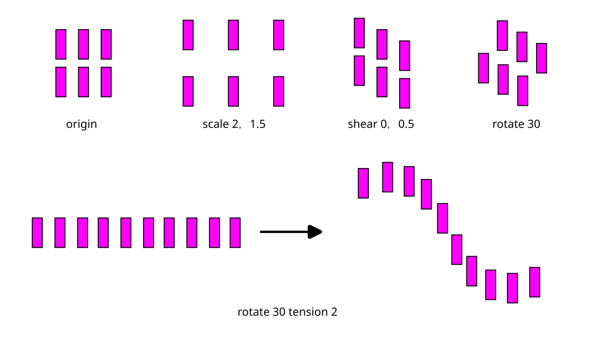

# Inkscape Layout Transform

An Inkscape extension that transforms the **layout** of a selection — spacing, shear and rotation — **without changing the size, shape or orientation of the objects**. All operations only translate objects, so object geometry is never modified.

## Usage

Select two or more objects, then go to **Extensions → Arrange → Layout Transform**.

| Parameter | Meaning | Default |
|---|---|---|
| Horizontal spacing scale | Scales horizontal gaps. `1` = unchanged, `0.5` = half, `2` = double. | `1.0` |
| Vertical spacing scale | Scales vertical gaps. Same convention. | `1.0` |
| Horizontal shear factor | `tan(α)` for position-only shear along X. `0` disables. | `0.0` |
| Vertical shear factor | `tan(β)` for position-only shear along Y. `0` disables. | `0.0` |
| Layout rotation angle | Rotates the layout around the selection center, in degrees. Positive = clockwise. `0` disables. | `0.0` |
| Tension | Modulates each object's displacement by its distance to the selection center. Positive values amplify the effect on elements closer to the center, negative values dampen it. `0` disables. | `0.0` |

Stages run in order: shear → spacing scale → rotate, with tension applied to the per-object displacement at each stage. Object sizes, shapes and orientation are preserved throughout.

## Installation

1. Copy `layout_transform.inx` and `layout_transform.py` into your Inkscape extensions directory:
   - **Windows:** `%APPDATA%\inkscape\extensions`
   - **Linux:** `~/.config/inkscape/extensions`
   - **macOS:** `~/.config/inkscape/extensions` (or `~/Library/Application Support/org.inkscape.Inkscape/config/inkscape/extensions`)
2. Restart Inkscape.

## License

MIT